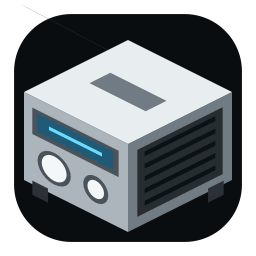

#  R SDR

R SDR는 AM/FM/SW/Air/T-DMB 대역의 간단한 수신을 위한 앱입니다. 자세한 SDR
기능을 원하시면 [CubicSDR](https://cubicsdr.com)을 이용하십시오.

- [RenkuOS — 설치 및 사용법](renkuos/README.ko.md)
- [macOS — 설치 및 사용법](macos/README.ko.md)
- [RenkuOS — Installation and usage (English)](renkuos/README.md)
- [macOS — Installation and usage (English)](macos/README.md)
